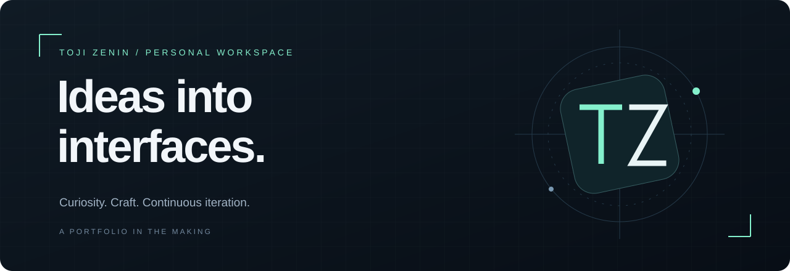

  

  <a href="#hello-im-toji">English</a> &nbsp; / &nbsp;
  <a href="#olá-sou-toji">Português</a> &nbsp; · &nbsp;
  <a href="https://github.com/TOJI-zenin-ui?tab=repositories">Explore my work ↗</a>

## Hello, I'm Toji.

**An idea is a starting point. The details make it worth using.**

I'm shaping a personal space for software, experiments and the thinking behind them. My aim is to turn curiosity into useful experiences, with clear interfaces and careful attention to how things work.

<table>
  <tr>
    <td width="33%" valign="top">
      01 / INTENT
      <h3>Start with a purpose.</h3>
      
A clear problem. A useful outcome. A reason for every feature.

    </td>
    <td width="33%" valign="top">
      02 / CRAFT
      <h3>Care for the details.</h3>
      
Readable interfaces, deliberate interactions and thoughtful defaults.

    </td>
    <td width="33%" valign="top">
      03 / ITERATION
      <h3>Keep making it better.</h3>
      
Explore an idea, learn from the result and refine the next version.

    </td>
  </tr>
</table>

### The next chapter

This portfolio is taking shape. Project highlights will appear here as public repositories become available, with the problem, the implementation and the current status of each project.

### Let's make something worth using.

Ideas, feedback or a collaboration in mind? [Start a conversation →](https://github.com/TOJI-zenin-ui/TOJI-zenin-ui/issues)

---

## Olá, sou Toji.

**Uma ideia é o ponto de partida. Os detalhes fazem valer a experiência.**

Estou construindo um espaço pessoal para software, experimentos e as ideias por trás deles. Meu objetivo é transformar curiosidade em experiências úteis, com interfaces claras e atenção a como tudo funciona.

Minha direção: começar com um propósito, cuidar dos detalhes e melhorar a cada versão.

### O próximo capítulo

Este portfólio está ganhando forma. Os destaques serão adicionados conforme houver repositórios públicos, apresentando o problema, a implementação e o estágio atual de cada projeto.

### Vamos criar algo que valha a pena usar.

Tem uma ideia, um feedback ou uma proposta de colaboração? [Vamos conversar →](https://github.com/TOJI-zenin-ui/TOJI-zenin-ui/issues)

TOJI ZENIN &nbsp; / &nbsp; CURIOSITY → CRAFT → ITERATION

